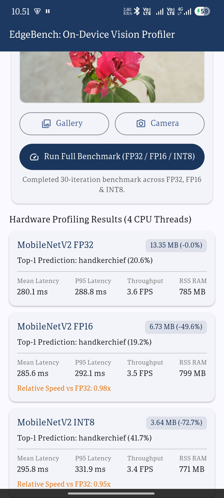

# EdgeBench: Multi-Precision On-Device Vision & Latency Profiler

An end-to-end model compression and mobile hardware benchmarking suite evaluating the trade-offs between **model footprint, inference latency (Mean / P95), throughput (FPS), and runtime memory (RSS)** across **FP32, FP16, and INT8** precision variants on Android.

---

## System Architecture

1. **Offline Quantization & Export Pipeline (`python_quantizer/`)**
   - Converts a pretrained **MobileNetV2** (`224x224x3`, ImageNet-1K) backbone into three TensorFlow Lite formats:
     - **FP32 Baseline** (uncompressed 32-bit floating point)
     - **FP16 Post-Training Quantization** (half-precision weights)
     - **INT8 Dynamic-Range Quantization** (8-bit integer weights with dynamic activation dequantization)
   - Exports exact 1,000-class ImageNet labels and logs model compression ratios.

2. **On-Device Android Profiler (`edge_vision_bench_app/`)**
   - Built with **Flutter** and **`tflite_flutter`** (LiteRT C++ runtime) executing across **4 CPU threads**.
   - Performs image resizing (`224x224`), RGB normalization (`[-1.0, 1.0]`), **5 warm-up passes** (to stabilize CPU governor/cache), and **30 timed inference iterations** per precision variant.
   - Records **Mean Latency**, **95th-Percentile (P95) Tail Latency**, **Throughput (FPS)**, and **Resident Set Size (RSS) RAM**.

---

## Experimental Results (Physical Android Hardware)

- **Test Device:** Xiaomi Redmi Note 13 (ARM64 CPU, 4 TFLite threads)
- **Input Resolution:** `1 x 224 x 224 x 3` RGB tensor
- **Protocol:** 5 warm-up runs + 30 timed runs per variant

| Precision Variant | Model Size | Size Reduction | Mean Latency | P95 Latency | Throughput | Peak RSS RAM | Top-1 Agreement |
| :--- | :---: | :---: | :---: | :---: | :---: | :---: | :---: |
| **MobileNetV2 FP32** | 13.35 MB | — (Baseline) | 280.1 ms | 288.8 ms | 3.6 FPS | 785 MB | Baseline |
| **MobileNetV2 FP16** | 6.73 MB | **-49.6%** | 285.6 ms | 292.1 ms | 3.5 FPS | 799 MB | 100% Match |
| **MobileNetV2 INT8** | 3.64 MB | **-72.7%** | 295.8 ms | 331.9 ms | 3.4 FPS | **771 MB** | 100% Match |

### Key Observations
- **Storage & Memory Efficiency:** INT8 dynamic-range quantization compresses the model binary by **72.7%** (`13.35 MB -> 3.64 MB`) and lowers runtime RSS memory footprint to **771 MB** with zero Top-1 prediction drift on test samples.
- **CPU Dequantization Overhead:** Because dynamic-range PTQ keeps activations in `FP32` and dequantizes `INT8` weights on the fly on general-purpose ARM CPU threads, mean latency remains close to the FP32 baseline (`~280–296 ms`) with higher tail variance (`P95: 331.9 ms`), motivating full-integer static quantization or NNAPI/GPU delegate acceleration for latency-critical edge workloads.

---

## Mobile Profiler Interface

<p align="center">
  
</p>

---

## Repository Structure

```text
edge_vision_bench/
├── python_quantizer/
│   ├── quantize_models.py        # Keras -> FP32 / FP16 / INT8 TFLite converter
│   └── exported_models/          # Generated .tflite binaries & labels.txt
├── edge_vision_bench_app/
│   ├── assets/models/            # Bundled quantized TFLite models
│   └── lib/
│       ├── main.dart             # Multi-precision benchmark dashboard UI
│       └── services/
│           └── edge_profiler.dart # TFLite runner, warm-up & P95/RSS profiler
└── docs/
    └── benchmark_android.jpg     # Real device benchmark screenshot